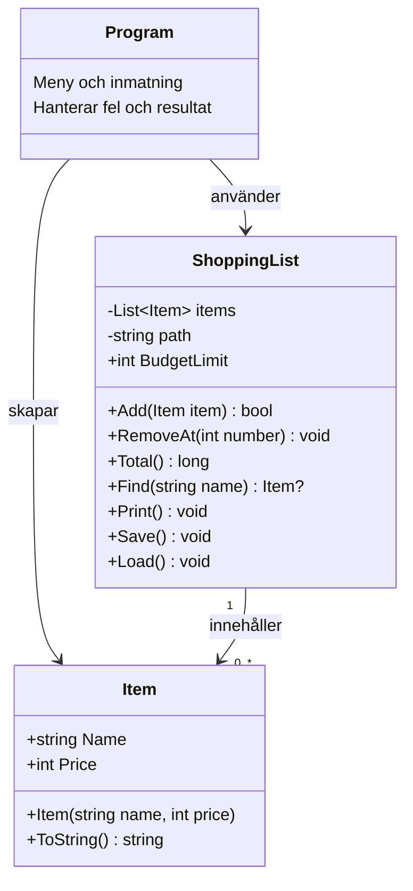

Fel och rättningar

1. Krasch vid inläsning av en tom rad

Problem: Programmet kraschade när filen innehöll en tom rad.

Orsak: Raden delades vid semikolon. En tom rad gav bara en del, men koden försökte läsa parts[1], som inte fanns.

Rättning: Tomma rader hoppas över. Programmet kontrollerar också antalet delar innan de används.

2. Krasch vid felaktig talinmatning

Problem: Text som hej i menyn, priset eller varunumret kunde få programmet att krascha.

Orsak: int.Parse användes för användarens inmatning.

Rättning: Jag använder int.TryParse. Om omvandlingen misslyckas visas ett meddelande och programmet återgår till menyn. Menyval utanför 1–5 hanteras också.

3. Krasch vid borttagning av ett nummer som inte finns

Problem: Programmet kraschade när användaren försökte ta bort exempelvis vara 99 från en kort lista.

Orsak: Numret användes utan att först kontrollera om varan fanns.

Rättning: Numret måste vara minst 1 och högst items.Count. Först därefter omvandlas numret till index genom att dra bort 1.

4. Krasch när filen saknas

Problem: Programmet kunde inte starta utan items.txt.

Orsak: Koden försökte läsa filen utan att hantera att den kunde saknas.

Rättning: Load() fångar FileNotFoundException och visar ett meddelande. Vid starten är listan tom och programmet kan fortsätta. Andra läsfel hanteras med specifika undantagstyper.

5. Fel totalsumma

Problem: Första varans pris räknades inte med.

Orsak: Loopen började på index 1, men första varan har index 0.

Rättning: Loopen börjar nu på 0. Summan använder även long, så att flera stora heltalspriser kan summeras utan att överskrida gränsen för int.

6. Misslyckat sparande doldes

Problem: Programmet kunde skriva ”Listan är sparad” trots att sparandet misslyckades.

Orsak: catch var tom och meddelandet om lyckat sparande låg efter hela try/catch.

Rättning: Sparfel visas för användaren. Koden fångar UnauthorizedAccessException och IOException. Meddelandet om lyckat sparande visas bara efter att filen har skrivits utan undantag.

Ytterligare rättning: namn och sökning efter inläsning

Problem: Inlästa namn kunde visas konstigt och inte hittas vid sökning.

Orsak: Filen sparades med radbrytningen \r\n, men delades bara vid \n. Därför kunde ett osynligt \r finnas kvar efter namnet.

Rättning: File.ReadAllLines läser raderna utan radbrytningstecknen. File.WriteAllLines används för sparandet.

Sökningen jämför fortfarande namn exakt. Stora och små bokstäver räknas som olika.

Övrig kontroll av fili

Felaktiga filrader hoppas över med ett meddelande. Priser i filen kontrolleras med TryParse. Varje rad delas bara vid det första semikolonet, så att ett semikolon i varunamnet kan bevaras.

Tester

Byt [ nnehåll] till [x] efter varje genomfört och godkänt test.

hej i menyn ger ett meddelande utan krasch.

Menyvalet 99 hanteras utan krasch.

Priset hej gör att varan inte läggs till.

hej som varunummer hanteras utan krasch.

Borttagning av nummer 0 eller ett nummer som inte finns nekas.

Borttagning från en tom lista hanteras utan krasch.

En giltig borttagning tar bort rätt vara.

Totalsumman stämmer när jag räknar för hand.

Programmet startar när items.txt saknas.

Namn och priser finns kvar oförändrade efter sparande och omstart.

En sparad och återinläst vara hittas med exakt samma namn.

Felaktiga filrader ger meddelanden utan att programmet kraschar.

Försök att spara till en mapp ger ett felmeddelande.

Misslyckat sparande visar inte ”Listan är sparad”.

Vad jag har lärt mig

............................................................

Skillnaden mellan Parse och TryParse.

Varför ett index måste kontrolleras före borttagning.

Varför ett fel inte ska döljas med en tom catch.

## Del 2 – Designval

Item kastar ArgumentException om namnet är tomt eller bara innehåller
blanksteg. Ett negativt pris ger ArgumentOutOfRangeException.

Add returnerar false om den nya totalsumman skulle överstiga budgeten.
Jag valde false eftersom en otillräcklig budget är ett förväntat resultat.
Program.cs kontrollerar svaret och visar ett meddelande.

Budgeten är 1000 kr. Exakt 1000 kr tillåts.
Load använder också Add. Varor som överskrider budgeten hoppas över
med ett meddelande.

Program.cs och Load fångar undantagen från Item så att programmet
kan fortsätta.

## Klassdiagram

Program-rutan representerar top-level-koden i Program.cs.